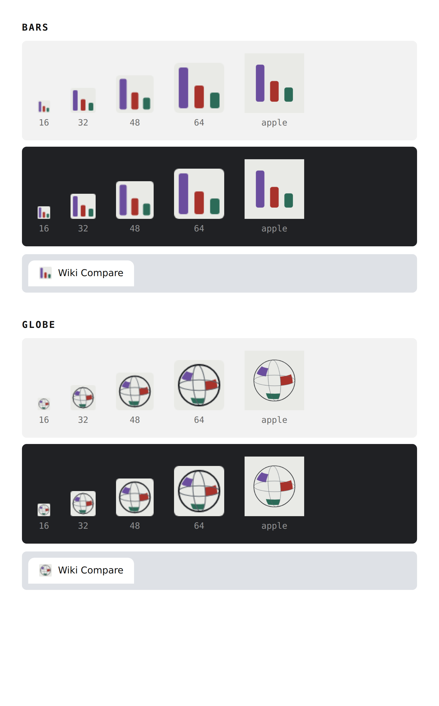

# Site icons

Two proposals, both drawn from marks the site already owns and both set on
paper (`--color-paper`) in the three inks the legend uses for contradiction,
omission and framing.



**Bars** — the wordmark's hover state, where the three strands drop onto a
shared baseline and step down in height (`components/Wordmark.tsx`). It is the
one that holds at 16px: three marks, three colours, obviously uneven.

**Globe** — the landing page's sphere, held still, with one cell of each colour
lit (`components/globe.ts`). It carries more of the site at 32px and above and
loses definition at 16px, where the wireframe closes up.

Bars is installed. To switch to the globe, replace the three files in `app/`
with the ones in `globe/`:

```sh
cp docs/icons/globe/icon.svg docs/icons/globe/favicon.ico docs/icons/globe/apple-icon.png app/
```

Next picks these up by filename — `app/icon.svg` for modern browsers,
`app/favicon.ico` (16/32/48) for the ones that still ask for it, and
`app/apple-icon.png` (180px, full bleed, since iOS applies its own mask) for
the home screen. No metadata changes are needed.
